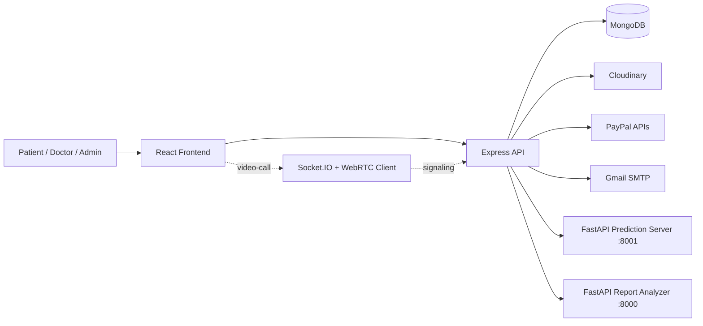

# SmartCare Platform

> AI-assisted healthcare management platform for patients, doctors, and admins.

[](https://github.com/gauravdev95/SmartCare-Platform)
[](https://react.dev/)
[](https://nodejs.org/)
[](https://fastapi.tiangolo.com/)
[](https://www.mongodb.com/)
[](#license)

## Overview

SmartCare Platform is a full-stack healthcare system built around three user roles:

- Patients can register, search doctors, book appointments, upload reports, join video calls, and rate doctors.
- Doctors can manage profiles, review appointments, upload prescriptions, and track patient feedback.
- Admins can review pending doctors and verify onboarding.

The repository also includes two Python-based healthcare intelligence services:

- A FastAPI prediction server for report-driven medical summaries.
- A FastAPI report analyzer for extracting abnormalities and specialist suggestions from uploaded reports.

The UI is branded in places as "Best HEALTH" and "HealthMate", while the repository name is SmartCare Platform.

## Problem Statement

Patients often need to:

- Find the right doctor quickly.
- Book an appointment without back-and-forth messaging.
- Share medical reports safely.
- Understand basic report findings before the consultation.
- Switch between in-person, chat, and video workflows.

On the provider side, doctors need a structured dashboard to manage bookings, prescriptions, and patient feedback. Admins need a way to verify doctors before they go live.

## Solution

SmartCare Platform brings the workflow into one place:

- Role-based authentication with JWT.
- Doctor discovery with specialization, location, fee, and rating filters.
- Appointment creation, completion tracking, and consultation handoff.
- Cloudinary-backed medical file uploads.
- AI/ML-assisted prediction and report analysis.
- PayPal payment integration for appointment payments.
- WebRTC and Socket.IO code for real-time consultation support.

## Key Features

- Role-based login for users, doctors, and admins.
- JWT authentication with server-side role checks.
- Doctor registration with admin verification.
- Doctor search by specialization, location, and fees.
- Patient dashboard with appointments and report upload.
- Doctor dashboard with appointment tracking and patient ratings.
- Prescription upload and report upload flows.
- PayPal order creation and capture endpoints.
- AI medical report prediction and specialist suggestion.
- OCR-based extraction from uploaded medical reports.
- Cloudinary uploads for images, PDFs, and certificates.
- Email reminders for upcoming video calls.

## System Architecture



### Request Flow

1. The React app sends authenticated requests to the Express API.
2. The backend validates JWTs and enforces roles before serving protected data.
3. Appointments, payments, ratings, and predictions are persisted in MongoDB.
4. Uploaded files are sent to Cloudinary when needed.
5. Medical report prediction is delegated to the Python prediction service.
6. Report analysis is handled by a separate Python service that reads PDF/image content and returns abnormal parameters plus a specialist suggestion.

### Data Flow

- Authentication tokens are stored in browser `localStorage`.
- Doctor and user profile data are fetched from MongoDB through the backend.
- Appointment state drives dashboards, consultation links, prescriptions, and ratings.
- Prediction results are stored in the `Prediction` collection.

## Tech Stack

### Frontend

- React 18
- React Router v6
- Tailwind CSS
- Material UI
- Framer Motion
- Axios
- Socket.IO client
- Tesseract.js
- PDF.js
- browser-image-compression

### Backend

- Node.js
- Express 5
- Mongoose
- JWT
- bcrypt
- Joi validation
- Multer
- Cloudinary
- Nodemailer
- Socket.IO
- Winston logging

### Database

- MongoDB
- Mongoose models for users, doctors, admins, appointments, payments, ratings, and predictions

### Authentication

- JWT bearer tokens
- Role-based middleware on the backend
- Client-side protected routes using stored role/token state
- Password hashing with bcrypt

### AI / ML

- FastAPI
- Gradio UI for the local ML demo
- EasyOCR
- Tesseract OCR
- PyPDF2
- joblib-loaded model file (`ml/multi_disease_model.pkl`)
- Rule-based medical scoring and summary generation

### DevOps / Deployment

- Dockerfile for the report-analysis service
- Docker Compose file for the report-analysis service
- Render-hosted backend/service URLs in the current code
- Cloudinary for file storage
- Gmail SMTP for reminder emails
- PayPal Orders API for payments

## Project Structure

```text
SmartCare Platform/
  backend/
    config/
    controllers/
    middleware/
    models/
    routes/
    utils/
    index.js
    package.json
  frontend/
    src/
      api/
      components/
      context/
      layouts/
      pages/
      routes/
      services/
      socket/
    package.json
  ml/
    app.py
    server.py
    multi_disease_model.pkl
    records.db
    requirements.txt
  service/
    app.py
    Dockerfile
    docker-compose.yml
    requirements.txt
  assets/
```

## Installation

### Prerequisites

- Node.js 18+ recommended
- Python 3.11+ recommended
- MongoDB connection string
- Cloudinary account
- Gmail account for SMTP
- PayPal developer credentials

### 1. Clone the repository

```bash
git clone https://github.com/gauravdev95/SmartCare-Platform.git
cd "SmartCare Platform"
```

### 2. Install backend dependencies

```bash
cd backend
npm install
```

### 3. Install frontend dependencies

```bash
cd ../frontend
npm install
```

### 4. Install ML service dependencies

```bash
cd ../ml
pip install -r requirements.txt
```

### 5. Install report-analysis service dependencies

```bash
cd ../service
pip install -r requirements.txt
```

## Environment Variables

Create your environment files locally. The code reads the following values:

| Variable | Used In | Purpose |
| --- | --- | --- |
| `MONGO_URL` | `backend/config/db.js` | MongoDB connection string |
| `JWT_SECRET` | `backend/middleware/auth.js`, controllers | Signs and verifies JWTs |
| `PORT` | `backend/index.js` | Express server port |
| `REACT_APP_API_URL` | `frontend/src/api/api.js` | Backend base URL in production |
| `CLOUDINARY_CLOUD_NAME` | `backend/config/cloudinary.js` | Cloudinary cloud name |
| `CLOUDINARY_API_KEY` | `backend/config/cloudinary.js` | Cloudinary API key |
| `CLOUDINARY_API_SECRET` | `backend/config/cloudinary.js` | Cloudinary API secret |
| `CLOUDINARY_FOLDER` | `backend/config/cloudinary.js` | Upload folder name |
| `EMAIL_USER` | `backend/config/emailConfig.js` | Gmail sender account |
| `EMAIL_PASS` | `backend/config/emailConfig.js` | Gmail app password |
| `APP_BASE_URL` | `backend/utils/emailService.js` | Video-call link generation |
| `PAYPAL_CLIENT_ID` | `backend/controllers/payment.controller.js` | PayPal OAuth client ID |
| `PAYPAL_SECRET` | `backend/controllers/payment.controller.js` | PayPal OAuth secret |
| `PAYPAL_API` | `backend/controllers/payment.controller.js` | PayPal API base URL |
| `ML_SERVER_URL` | `backend/routes/predict.route.js` | Prediction service URL |

### Suggested local `.env` files

- `backend/.env`
- `frontend/.env`

## Running Locally

### Backend

```bash
cd backend
npm start
```

Default port: `5000`

### Frontend

```bash
cd frontend
npm start
```

The frontend uses `http://127.0.0.1:5000` automatically during local development.

### ML prediction server

```bash
cd ml
python server.py
```

Default port: `8001`

### Optional Gradio demo

```bash
cd ml
python app.py
```

This launches the local OCR summary UI on port `7860`.

### Report-analysis service

```bash
cd service
uvicorn app:app --host 0.0.0.0 --port 8000
```

Note: the current backend route for report analysis points to a hosted Render URL in `backend/routes/predict.route.js`. Run the local service if you plan to point that route at your own instance.

## API Endpoints

### Authentication and Users

- `POST /api/users/register`
- `POST /api/users/login`
- `GET /api/users/profile`
- `GET /api/users/search-doctors`

### Doctors

- `POST /api/doctors/register`
- `POST /api/doctors/login`
- `GET /api/doctors/profile`
- `GET /api/doctors/profile/:id`
- `GET /api/doctors/unverified`
- `PUT /api/doctors/update-profile`
- `GET /api/doctors/getdoctor`

### Admin

- `POST /api/admin/login`
- `POST /api/admin/register` (disabled in controller)
- `GET /api/admin/profile`
- `GET /api/admin/unverified-doctors`
- `PUT /api/admin/verify-doctor/:id`
- `GET /api/admin/stats`

### Appointments

- `POST /api/appointments`
- `GET /api/appointments/user/:userId`
- `GET /api/appointments/doctor/:doctorId`
- `GET /api/appointments/:appointmentId`
- `PUT /api/appointments/:id/test-upload`
- `PUT /api/appointments/:id/test-prescription`
- `PUT /api/appointments/:id/complete`

### Payments

- `POST /api/paypal/create-order`
- `POST /api/paypal/capture-order/:orderId`
- `GET /api/paypal/payments/:id`

### Ratings

- `POST /api/ratings`
- `GET /api/ratings/doctor/:doctorId`

### Report Prediction

- `POST /api/report/predict`
- `POST /api/report/analyze`

### Email

- `POST /api/send/send-email`

## Database Schema Overview

### User

- `name`
- `email`
- `password`
- `location`
- `role`
- timestamps

Note: the user controller also reads `phoneNumber`, but that field is not declared in the current schema.

### Doctor

- `userId`
- `profilePhoto`
- `licenseNumber`
- `phoneNumber`
- `fees`
- `specialization`
- `certification`
- `isVerified`
- `availability[]`
- `about`
- `experience`
- `achievements`
- `other`
- timestamps

Note: the doctor controller also writes `name`, `email`, `password`, and `location`, but those fields are not declared in the current schema.

### Admin

- `name`
- `email`
- `password`
- `role`
- timestamps

### Appointment

- `user`
- `doctor`
- `date`
- `time`
- `description`
- `roomId`
- `prescription`
- `suggestedTests`
- `testReports[]`
- `review`
- `callStartedAt`
- `callEndedAt`
- `completedAt`
- `paymentId`
- `paymentStatus`
- `isFollowUp`
- `status`
- timestamps

### Payment

- `userId`
- `doctorId`
- `amount`
- `currency`
- `paymentStatus`
- `orderId`
- `captureId`
- `description`
- timestamps

### Rating

- `user`
- `doctor`
- `appointment`
- `rating`
- `comment`
- `createdAt`

### Prediction

- `patientName`
- `age`
- `gender`
- `symptoms`
- `healthDetails`
- `reportFile`
- `result`
- timestamps

## AI/ML Pipeline

### Prediction flow

1. The user submits a form and optionally uploads a PDF, JPG, JPEG, or PNG report.
2. The frontend sends multipart form data to `POST /api/report/predict`.
3. The backend forwards the payload to the Python prediction server at `ML_SERVER_URL`.
4. The prediction server:
   - extracts fields from the report image when available,
   - loads `multi_disease_model.pkl`,
   - applies rule-based health scoring,
   - builds a risk level,
   - generates a readable summary,
   - returns specialist suggestions and recommendations.
5. The backend stores the final prediction in MongoDB in the `Prediction` collection.

### Report-analysis flow

1. The analyzer receives a report URL.
2. It downloads the report.
3. PDF text is extracted with `PyPDF2`.
4. Images are read with `pytesseract`.
5. Medical values are matched with regex patterns and compared against normal ranges.
6. The service returns abnormal parameter counts, a risk level, and a specialist suggestion.

## Screenshots


Additional UI assets are available in `frontend/src/assert/`.

## Deployment

- The backend is a standalone Express server.
- The frontend is a standalone React app.
- The ML prediction service runs separately from the main API.
- The report-analysis service has its own Python app, Dockerfile, and compose file.
- Cloudinary stores uploaded medical documents and images.
- PayPal is used for payment order creation and capture.
- Gmail SMTP is used for appointment reminder emails.

### Docker

The repository currently ships a Dockerfile and a Docker Compose file for the `service/` Python analyzer only. There is no top-level compose file for the full stack yet.

## Performance Highlights

- Separates heavy OCR and prediction work into Python services instead of keeping it inside the Express API.
- Uses direct Cloudinary uploads for large media and document files.
- Validates report MIME types and enforces a 10 MB upload limit in the prediction route.
- Uploads doctor profile photos and certifications in parallel during signup.
- Keeps the core authentication flow lightweight with JWT plus role checks.

## Security Features

- Passwords are hashed with `bcrypt`.
- Protected routes require a bearer JWT.
- Server-side role checks guard sensitive endpoints.
- Doctor onboarding is gated by admin verification.
- Prediction uploads are restricted to PDF/JPG/JPEG/PNG files.
- CORS is enabled explicitly on the backend and Python services.
- Secrets are expected in environment variables rather than hard-coded in the backend.

## Future Improvements

- Align the Mongoose schemas with the fields used by the controllers.
- Replace hard-coded deployment URLs with environment-driven configuration.
- Finish parity between the documented UI pages and the backend routes they call.
- Add a top-level `.env.example`.
- Add a top-level `LICENSE` file.
- Add automated tests for auth, appointments, and prediction flows.
- Wire the Socket.IO server consistently for the video-call experience.
- Consolidate the multiple healthcare brands used across the UI into one product name.

## Contributing

Contributions are welcome.

1. Fork the repository.
2. Create a feature branch.
3. Make your changes with clear commits.
4. Test the affected flow locally.
5. Open a pull request with a concise description.

## License

This project is licensed under the MIT License — see the [`LICENSE`](LICENSE) file at the repository root.

## Author

- Gaurav Yadav
- GitHub: https://github.com/gauravdev95
- LinkedIn: https://www.linkedin.com/in/gauravyadav95/
